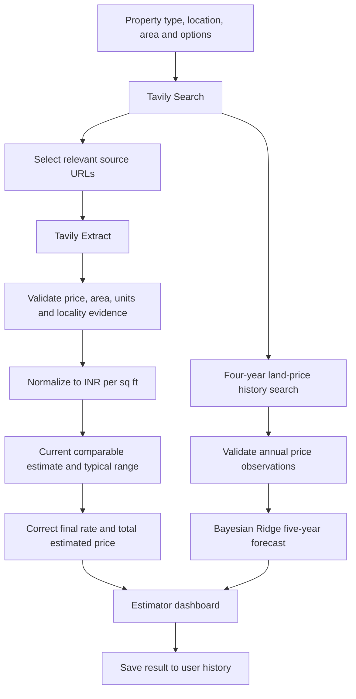
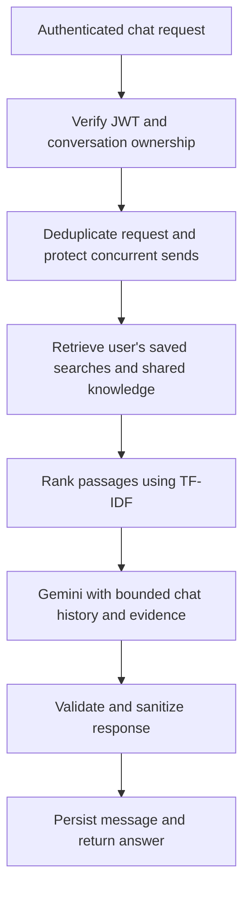

# 🏡 LandWise AI

### Evidence-first property price intelligence, affordability analysis, and AI-assisted property research

LandWise AI is a full-stack real-estate research application that estimates property prices from publicly discoverable web evidence, analyzes affordability, visualizes historical land-price trends, and produces **five-year machine-learning forecasts**. Signed-in users can save their research and discuss individual results with a **Gemini-powered, retrieval-augmented (RAG) assistant**.

> **What makes it different:** The current-price estimator uses validated property comparables rather than asking a language model to invent a valuation. **Tavily** supplies source discovery and extracted evidence; deterministic parsing and unit normalization support price estimates; **Bayesian Ridge** powers land-price forecasting; **Gemini** powers the separate, evidence-grounded chatbot.

<!-- Optional: add your actual deployed URL, repository badges, and screenshots here. -->

## ✨ Features

### 🔎 Property price estimation
- Search by location and property characteristics, with support for **Land / Plot**, residential property, and commercial-property workflows.
- Discover candidate listings and property sources through **Tavily Search**; extract selected pages through **Tavily Extract**.
- Validate explicit prices, areas, and units; reject unrelated numbers or malformed evidence.
- Normalize comparable prices to **INR per sq ft** before calculations.
- Display **Estimated Rate**, **Estimated Price**, and a **Typical Price Range** derived from current comparable observations.
- For commercial properties, support purpose selections including **Office, Shop, Floor, and Warehouse**.
- When an estimated rate falls outside the observed typical range, use the **midpoint of that range**; otherwise preserve the calculated rate. Recompute total estimated price using the final rate and requested area.
- Where usable evidence is insufficient, report limitations rather than manufacture market prices.

### 📈 Historical trends and five-year forecasts
- Retrieve up to **four completed years** of land-price observations through Tavily and normalize them to ₹/sq ft.
- Plot responsive historical charts with annual/central values and year-wise minimum and maximum values.
- Plot the next **five years** with ML predictions and forecast minimum/maximum bands.
- Forecast using **Bayesian Ridge regression on log(price per sq ft)**, with leave-one-out MAPE diagnostics and guardrails against extreme extrapolation.
- Scale the displayed forecast to the corrected current estimated rate while retaining the model's year-to-year growth pattern; historical observations remain unchanged.
- Show rising and falling/flat trend-dependent continuity of forecast bands.
- Do not fabricate missing annual observations: insufficient history may mean no forecast.

### 📐 Property-area and price-unit conversions
Switch displayed price units across:

| Unit | Supported |
| --- | :---: |
| Square foot (sq ft) | ✅ |
| Square yard (sq yd) | ✅ |
| Square meter (sq m) | ✅ |
| Acre | ✅ |
| Hectare | ✅ |
| Cent | ✅ |
| Gunta | ✅ |
| Marla | ✅ |
| Bigha | ✅ |

- The backend exposes `typical_price_min`, `typical_price_max`, and `typical_price_unit` in canonical **₹/sq ft**.
- The frontend converts the canonical values **once** for display, avoiding double-conversion bugs when changing units.
- Changing the chart unit does **not** retrain the ML model.
- **Note:** Bigha size varies by jurisdiction; its conversion is approximate.

### 💰 Affordability calculator
- Enter a **budget** to evaluate feasible property options.
- **Land / Plot:** estimate purchasable area and present it in supported land-area units.
- **Flat / Apartment, Villa, Independent House:** compare **1–5 BHK** possibilities without requiring users to preselect a BHK value.
- Preserve residential status filters: **Ready to Move, Under Construction, Resale**.
- **Commercial:** evaluate practical categories including Office, Shop, Commercial Floor, and Warehouse.
- The frontend sends `budget` as a numeric field to the `/affordability` API.

### 🤖 Gemini-powered RAG property assistant
- Floating chat widget available on authenticated application screens.
- Ask natural-language questions about saved estimates, property rates, affordability concepts, and indexed help documentation.
- **Ask about this result** opens a conversation tied to the **exact saved search** from a new estimate or the History page.
- Retrieve context from **the signed-in user's own saved searches** and **shared operator-managed `.md` / `.txt` knowledge**.
- Use local **TF-IDF lexical retrieval**—no paid embeddings service or external vector database required.
- Ground Gemini responses in retrieved evidence and recent conversation context; do not treat retrieved content as instructions.
- Store conversations and individual messages in MongoDB; reopen chats after refresh/restart, browse older messages, and delete conversations.
- Support retries, request-ID deduplication, and protection against simultaneous sends to the same conversation.
- Sanitize internal numeric citation markers and hide the raw retrieved-evidence diagnostic block from the user-facing answer.
- If a selected saved search was deleted, the assistant reports that the source is unavailable instead of silently selecting another property.

**Assistant scope:** The chatbot explains existing research; it **does not perform a new live valuation**, refresh prices, execute model-generated database queries, or automatically crawl websites. Run the estimator again for fresh market evidence.

### 🔐 Authentication and accounts
- Landing page with **Log in** and **Sign up** entry points; estimator and chat are protected behind authentication.
- Account signup with **six-digit Gmail SMTP email OTP** verification.
- Forgot-password flow using email OTP and a new password.
- OTP expiration, attempt limits, hashed OTP storage, and invalidation after successful use.
- Password visibility toggles on relevant authentication forms.
- Passwords hashed using salted **PBKDF2-HMAC-SHA256**; JWT bearer-token sessions protect API access.
- User-specific saved searches and conversation access controls.

### 🗂️ Search history and persistence
- Save property-price and affordability requests and responses to user-scoped history.
- Retain up to **200 recent searches per user** in the documented account-store implementation.
- Review past research and delete individual search entries.
- Link chat sessions to a specific saved search by its ID.
- MongoDB-backed chat conversations, messages, and indexed knowledge chunks.
- Optional migration utility for older local JSON accounts; configurable `MONGODB_REQUIRED` mode to prevent silent fallback for account data.

## 🧠 How it works

### Property estimation and forecasting



### Saved-history RAG assistant



The assistant sends selected relevant evidence and recent messages to Gemini. The documented implementation uses **up to 12 recent messages and five retrieved passages**; lexical retrieval is not the same as embedding-based semantic search.

## 🛠️ Technology stack

| Layer | Technologies |
| --- | --- |
| Frontend | React, TypeScript, Vite, responsive CSS and SVG charts |
| Backend | Python, FastAPI, Pydantic, Uvicorn |
| Property research | Tavily Search and Tavily Extract, deterministic evidence parsing |
| Forecasting | Bayesian Ridge regression and validation diagnostics |
| AI chat | Google Gemini REST API, retrieval-augmented generation |
| Retrieval | TF-IDF over saved searches and shared text/Markdown knowledge |
| Database | MongoDB; optional legacy JSON account fallback/migration |
| Authentication | JWT, PBKDF2 password hashing, Gmail SMTP OTP |
| Testing | pytest, mongomock, TypeScript compiler, Vite build |

## 📁 Key project paths

```text
LandWise/
├── backend/
│   ├── app/
│   │   ├── main.py                  # FastAPI application and routes
│   │   ├── models.py                # Request/response schemas
│   │   ├── routers/
│   │   │   └── chat.py              # Chat endpoints
│   │   └── services/
│   │       ├── chat_store.py        # Persistent conversations and messages
│   │       ├── retrieval_service.py # User-history and document retrieval
│   │       ├── gemini_service.py    # Grounded Gemini chat responses
│   │       └── user_store.py        # Accounts and saved searches
│   ├── knowledge/
│   │   └── landwise-help.md         # Starter shared knowledge
│   ├── tests/
│   │   └── test_chat.py
│   ├── ingest_knowledge.py
│   ├── migrate_local_users.py
│   ├── requirements.txt
│   ├── requirements-dev.txt
│   └── .env.example
├── frontend/
│   ├── src/
│   │   ├── components/ChatWidget.tsx
│   │   ├── pages/Estimator.tsx
│   │   ├── pages/History.tsx
│   │   ├── App.tsx
│   │   └── styles.css
│   └── .env.example
└── README.md
```

*This is a map of the important files documented in the supplied release notes, not an exhaustive source-tree listing.*

## 🚀 Local installation

### Prerequisites
- **Python 3.11+**
- **Node.js 20+** and npm
- **MongoDB** running locally or a valid MongoDB connection URI
- Tavily API key, Gemini API key/model access, and Gmail SMTP app password for OTP flows

### 1. Backend

From the project root, open a terminal:

```powershell
cd backend
py -3.11 -m venv .venv
.\.venv\Scripts\Activate.ps1
python -m pip install -r requirements.txt
Copy-Item .env.example .env
```

Configure `backend/.env` using the supplied example file. Relevant settings include:

```dotenv
MONGODB_URI=mongodb://127.0.0.1:27017
MONGODB_DB=landwise_ai
MONGODB_REQUIRED=true
TAVILY_API_KEY=your_tavily_key
GEMINI_API_KEY=your_gemini_key
GEMINI_MODEL=your_available_model_id
JWT_SECRET=generate_a_long_random_secret
OTP_HASH_SECRET=generate_a_different_long_random_secret
GMAIL_SMTP_HOST=smtp.gmail.com
GMAIL_SMTP_PORT=587
GMAIL_SMTP_USERNAME=your_email@gmail.com
GMAIL_SMTP_APP_PASSWORD=your_google_app_password
GMAIL_FROM_EMAIL=your_email@gmail.com
OTP_EXPIRE_MINUTES=10
OTP_MAX_ATTEMPTS=5
```

These are **example values**, not credentials. Keep existing valid settings and secrets when upgrading an existing installation. To generate each random secret:

```powershell
python -c "import secrets; print(secrets.token_urlsafe(48))"
```

Index the included help documents and start the API:

```powershell
python ingest_knowledge.py
python -m uvicorn app.main:app --reload --host 127.0.0.1 --port 8000
```

API documentation: **http://127.0.0.1:8000/docs**

### 2. Frontend

In another terminal, from the project root:

```powershell
cd frontend
Copy-Item .env.example .env
npm ci
npm run dev -- --host 127.0.0.1
```

Set `VITE_API_BASE_URL` in `frontend/.env` to match your backend configuration, then open **http://127.0.0.1:5173**. Restart Vite after changing its environment variables. If the lockfile is unavailable or incompatible, install dependencies with `npm install` instead.

On macOS/Linux, create and activate the Python virtual environment using `python3 -m venv .venv` and `source .venv/bin/activate`; copy `.env.example` with `cp`.

### 3. Optional: migrate existing local accounts

Back up both account stores before migrating. From `backend/`:

```powershell
python migrate_local_users.py "C:\path\to\original\LandWise\backend\data\users.json"
```

The migration is designed not to overwrite matching accounts. Preserve the existing MongoDB database name and JWT secret when upgrading to avoid losing access to existing records or invalidating sessions.

### 4. Add knowledge for the assistant

Place trusted UTF-8 `.md` or `.txt` documents under `backend/knowledge/`, then run:

```powershell
python ingest_knowledge.py
```

The documented starter supports up to **2,000 shared chunks**, with individual files under **1 MB**. Re-ingestion replaces the shared indexed corpus. **Do not put private user data into shared knowledge**: all signed-in users can retrieve it. Automatic PDF parsing and website crawling are not part of this ingestion flow.

## 🔌 API overview

| Route | Purpose |
| --- | --- |
| `POST /property-price` | Calculate an evidence-based property estimate |
| `POST /affordability` | Evaluate property options against a budget |
| `POST /ingest-sources` | Existing protected source-ingestion workflow |
| `GET /auth/history` | List a signed-in user's saved searches |
| `DELETE /auth/history/{id}` | Delete a saved search |
| `/chat` endpoints | Manage conversations and send/retrieve messages |
| `GET /docs` | Interactive FastAPI/OpenAPI documentation |

Protected property, history, and chat operations require appropriate authentication. Refer to `/docs` for the **exact chat endpoint methods, request schemas, and response payloads**; the supplied Markdown files do not enumerate every chat route.

## 🧪 Testing and validation

Backend:

```powershell
cd backend
python -m pip install -r requirements-dev.txt
python -m pytest -q
```

Frontend:

```powershell
cd frontend
npm ci
npm run build
```

The supplied validation report records:
- **21 backend tests passed**.
- **TypeScript compilation and Vite production build passed** in that delivery's validation environment.
- **Python source compilation passed**.
- Tests covered conversation ownership, persistence, retrieval isolation, message ordering/pagination, retry deduplication, concurrency protection, deletion, and Gemini response handling.

**Validation scope:** The tests used `mongomock` and mocked Gemini responses. They did **not** establish live Gemini/Tavily/SMTP connectivity, real MongoDB end-to-end behavior, or full browser UI verification. A separate V8 change report noted a platform-specific Rollup dependency problem during bundling in its environment; reinstalling dependencies on the target machine is recommended if encountered. These are release-documentation results, **not a fresh test run against this README or the current source tree**.

## 🔒 Privacy and security considerations

- Use strong, distinct JWT and OTP secrets and keep `.env` out of Git.
- Use a Gmail **App Password**, not the account's ordinary password.
- Chat retrieval is scoped to the authenticated user's own saved searches; shared help documents are intentionally accessible across signed-in accounts.
- Conversation ownership is enforced on reads and deletes, and request IDs prevent duplicate answers on retries.
- Avoid committing account exports, local database files, keys, dependency folders, and build outputs.
- Existing stored chat messages may remain until their conversation is deleted even if a referenced property search is removed.
- Review authentication, database availability, CORS, secrets management, rate limits, and deployment settings before making the application publicly accessible.

## ⚠️ Accuracy and functional limitations

- Public listing prices often represent **asking prices**, not completed-sale transaction prices.
- Some locations may have too little usable evidence for a confident estimate or historical forecast.
- Forecasts are statistical projections, **not guaranteed future prices or investment advice**.
- The current pricing normalization is **INR-focused**.
- Bigha is a region-dependent area unit and is approximate.
- TF-IDF retrieval is lexical; it does **not** provide dense-vector semantic retrieval.
- The chatbot does not autonomously refresh estimates or retrieve live market data.
- Knowledge ingestion supports text/Markdown, not built-in PDF parsing or automated crawling.
- The implementation is documented as a modest/local deployment starter; production scaling requires additional evaluation.

## 🗺️ Roadmap ideas

*Potential enhancements—not claims about features already implemented:*

- Production deployment and automated CI/CD.
- More comprehensive end-to-end browser tests and live service integration tests.
- Optional semantic/vector retrieval and document upload processing.
- Expanded geographic coverage and stronger independent price validation.
- Monitoring, caching, and operational hardening for larger traffic volumes.

## 📸 Screenshots and demo

Add actual application screenshots or a demo link when available. Suggested captures: landing page, price estimator, historical/forecast charts, affordability calculator, saved history, and RAG chatbot.

## 📄 License

No license was specified in the supplied project documentation. Add a `LICENSE` file and update this section if you intend to grant others permission to reuse or modify the code.

---

**LandWise AI** — Research property prices with evidence, explore affordability, visualize trends, and revisit your findings with AI assistance.
